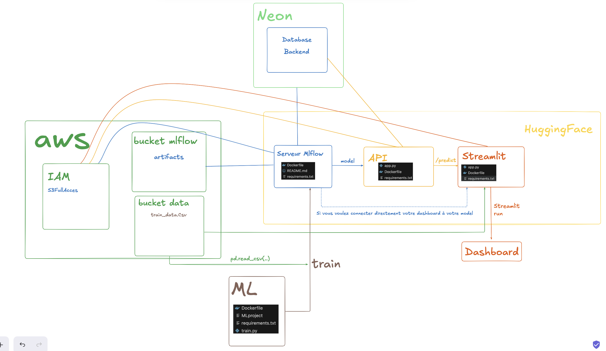

# 🚀 Séance API — servir un modèle MLflow 3 avec FastAPI + Docker

> Ce README couvre **la séance "API"** : récupérer proprement un modèle depuis MLflow 3, puis construire pas à pas une API FastAPI qui le sert, en la développant **dans Docker** avec un bind mount.
> On part du principe que le modèle `ibm_attrition_detector` est **déjà entraîné et enregistré** dans le registre MLflow (alias `champion`). L'entraînement reste dans `train_repo/` pour référence — voir [`README_projet_complet.md`](README_projet_complet.md) pour la vue d'ensemble (MLflow sur Hugging Face, Streamlit, etc.).



---

## 📁 Ce qu'on utilise aujourd'hui

```text
full-deployment-project/
├── mlflow/
│   ├── train_dev.ipynb        # 1️⃣ notebook : comment récupérer un modèle depuis MLflow 3
│   ├── Dockerfile             # serveur MLflow (local en Docker, ou Hugging Face)
│   ├── requirements.txt
│   └── .env.example           # → à copier en .env
├── fastapi_demo_aifs02/
│   ├── app.py                 # 2️⃣ l'API construite endpoint par endpoint
│   ├── api_dev.ipynb          # 3️⃣ notebook : on teste chaque endpoint avec requests
│   ├── Dockerfile
│   ├── requirements.txt
│   ├── .env.example           # → à copier en .env
│   └── scripts/               # lancement en mode dev (mac/linux, PowerShell, cmd)
├── train_repo/                # (référence) entraînement MLProject du modèle IBM
├── api_demo/                  # (référence) version "propre" de l'API pour Hugging Face
├── streamlit-app/             # (référence) front
├── conda.yaml                 # env local pour les notebooks
└── README_projet_complet.md   # README du projet complet
```

### Prérequis

```bash
conda env create -f conda.yaml      # Python 3.11, mlflow 3.5.0, scikit-learn 1.6.1…
conda activate mlflow-train-aifs02
```

Docker Desktop lancé. Un serveur MLflow accessible (voir étape 0).

---

## 0️⃣ Le serveur MLflow (rappel)

Pendant la séance, le serveur MLflow tournait **en local dans Docker sur le port 4000**, avec un backend Postgres (Neon) et les artefacts sur S3.

```bash
cd mlflow
cp .env.example .env            # puis remplir les valeurs
docker build -t mlflow-server .
docker run -it --rm -p 4000:4000 --env-file .env mlflow-server
```

→ UI sur <http://localhost:4000>. Si ton serveur est déployé (Hugging Face / EC2), remplace simplement l'URL dans les `.env`.

> 💡 Le serveur est lancé avec `--default-artifact-root s3://…` : il **ne sert pas** les artefacts lui‑même, il renvoie un chemin `s3://` au client. Conséquence : **tout client qui charge un modèle (notebook, API) a besoin des clés AWS** dans son environnement. C'est pour ça qu'elles sont dans le `.env` de l'API.

---

## 1️⃣ Récupérer un modèle depuis MLflow 3 — `mlflow/train_dev.ipynb`

La fin du notebook (section *"Puis pour récupérer le modèle"*) est le cœur de ce qu'on réutilise dans l'API.

### Ce qui change avec MLflow 3

| Avant (MLflow 1.x / 2.x)                              | MLflow 3                                                                 |
| :---------------------------------------------------- | :----------------------------------------------------------------------- |
| Stages `Staging` / `Production`                       | **Alias** libres : `champion`, `challenger`…                             |
| `models:/<name>/Production`                           | `models:/<name>@<alias>`                                                 |
| `log_model(model, artifact_path="model")`             | `log_model(model, name="model", registered_model_name=…)`                |
| Le modèle est un artefact d'un run                    | Le modèle est une entité à part entière (`model_id = m-xxxx…`)           |

### Le code minimal

```python
import os, mlflow
from dotenv import load_dotenv

load_dotenv(override=True)
mlflow.set_tracking_uri(os.environ["MLFLOW_TRACKING_URI"])   # http://localhost:4000 depuis le notebook

REGISTERED_MODEL_NAME = "ibm_attrition_detector"
MODEL_ALIAS = "champion"
MODEL_URI = f"models:/{REGISTERED_MODEL_NAME}@{MODEL_ALIAS}"   # 'models:/ibm_attrition_detector@champion'

# Deux façons de charger :
MODEL_pyfunc = mlflow.pyfunc.load_model(MODEL_URI)   # générique, ne connaît que .predict()
MODEL        = mlflow.sklearn.load_model(MODEL_URI)  # le vrai objet sklearn (Pipeline) → predict_proba, steps, etc.
```

`mlflow.pyfunc.load_model` affiche d'où vient le modèle (`artifact_path: s3://…/models/m-…/artifacts`, `flavor: mlflow.sklearn`, `run_id`). `mlflow.sklearn.load_model` renvoie le `Pipeline(Preprocessing → RandomForest)` tel qu'il a été entraîné : **le preprocessing est embarqué**, on lui envoie donc les colonnes brutes.

### Vérification avant de passer à l'API

```python
filename = "https://full-stack-assets.s3.eu-west-3.amazonaws.com/Deployment/ibm_hr_attrition.xlsx"
df = pd.read_excel(filename, index_col=0)
echantillon = df.sample(10, random_state=0).drop("Attrition", axis=1)
MODEL.predict(echantillon)   # array([0, 0, 1, 0, 1, 0, 1, 0, 0, 1])
```

👉 Ça marche dans le notebook → on peut copier ces lignes **telles quelles** en haut de `app.py`.

---

## 2️⃣ Développer l'API dans Docker : build une fois, bind mount ensuite

### Le message clé de la séance

> On ne rebuild l'image **que** quand on change une dépendance (`requirements.txt`) ou le `Dockerfile`.
> Pour modifier le code (`app.py`), on **monte le dossier local dans le conteneur** (bind mount) : chaque sauvegarde est vue immédiatement par le conteneur, sans rebuild.

### Build (une seule fois, ou quand `requirements.txt` change)

```bash
cd fastapi_demo_aifs02
cp .env.example .env            # et remplir
docker build -t api-aifs02 .
```

### Run en mode dev (bind mount + hot reload)

Le `pwd` s'écrit différemment selon le terminal — c'est la **seule** différence entre les OS :

**macOS / Linux (bash, zsh)**

```bash
docker run -it --rm -p 8001:8000 --env-file .env \
  --add-host=host.docker.internal:host-gateway \
  -v "$(pwd)":/app \
  api-aifs02 uvicorn app:app --host 0.0.0.0 --port 8000 --reload
```

**Windows — PowerShell**

```powershell
docker run -it --rm -p 8001:8000 --env-file .env `
  -v "${PWD}:/app" `
  api-aifs02 uvicorn app:app --host 0.0.0.0 --port 8000 --reload
```

**Windows — invite de commandes (cmd)**

```bat
docker run -it --rm -p 8001:8000 --env-file .env ^
  -v "%cd%:/app" ^
  api-aifs02 uvicorn app:app --host 0.0.0.0 --port 8000 --reload
```

Ces trois commandes sont dans `fastapi_demo_aifs02/scripts/`.

Décryptage :

| Option                                   | Pourquoi                                                                                                                                      |
| :--------------------------------------- | :-------------------------------------------------------------------------------------------------------------------------------------------- |
| `-p 8001:8000`                           | Uvicorn écoute sur 8000 **dans** le conteneur ; on l'expose sur **8001** côté machine → le notebook appelle `http://localhost:8001`.          |
| `-v "$(pwd)":/app`                       | Le bind mount : le dossier courant remplace `/app` dans le conteneur (le `WORKDIR` du Dockerfile). Le `COPY . .` de l'image est masqué.      |
| `--env-file .env`                        | Injecte `MLFLOW_TRACKING_URI` et les clés AWS. (Le `.env` est aussi lu par `load_dotenv` via le mount, les deux donnent le même résultat.)   |
| `uvicorn … --reload`                     | On **surcharge le `CMD`** du Dockerfile pour activer le rechargement automatique. Le `CMD` de l'image reste sans `--reload` : c'est la prod. |
| `--add-host=host.docker.internal:host-gateway` | **Linux uniquement** — voir l'écueil ci‑dessous. Inoffensif sur mac/Windows.                                                              |

> ⚠️ Avec `--reload`, chaque sauvegarde de `app.py` relance le module… donc **recharge le modèle depuis MLflow/S3** (quelques secondes). C'est le prix du confort en dev.

### 🪤 L'écueil `host.docker.internal` (rencontré encore aujourd'hui)

Dans `app.py`, `mlflow.set_tracking_uri("http://localhost:4000")` **ne marche pas** : l'API tourne dans un conteneur, et `localhost` désigne le conteneur lui‑même, pas ta machine. Le serveur MLflow, lui, est sur ta machine (ou dans un autre conteneur).

| Depuis…                        | `MLFLOW_TRACKING_URI`                         |
| :----------------------------- | :-------------------------------------------- |
| le notebook (sur la machine)   | `http://localhost:4000`                       |
| l'API (dans Docker)            | `http://host.docker.internal:4000`            |
| n'importe où, serveur déployé  | `https://<ton-space>.hf.space` (URL publique) |

C'est pour cette raison qu'il y a **deux `.env` différents** : `mlflow/.env` (localhost, pour le notebook) et `fastapi_demo_aifs02/.env` (host.docker.internal, pour l'API).

- Sur **Docker Desktop (mac / Windows)**, `host.docker.internal` existe nativement.
- Sur **Linux**, il faut l'ajouter à la main : `--add-host=host.docker.internal:host-gateway`.

Symptôme typique si on se trompe : `MlflowException: API request to http://localhost:4000/api/2.0/mlflow/registered-models/alias failed … Connection refused`, au démarrage du conteneur.

### Quand faut-il rebuild ?

| Je modifie…                    | Rebuild ? |
| :----------------------------- | :-------: |
| `app.py`                       |   ❌ non  |
| `.env`                         |   ❌ non (juste relancer le `docker run`) |
| `requirements.txt`             |   ✅ oui  |
| `Dockerfile`                   |   ✅ oui  |
| un fichier en dehors du mount  |   ✅ oui  |

---

## 3️⃣ Construire les endpoints pas à pas — `app.py` + `api_dev.ipynb`

Chaque endpoint a été ajouté dans `app.py`, puis testé **immédiatement** dans `api_dev.ipynb` avec `requests`. Les codes HTTP rencontrés font partie de la leçon.

```python
import requests
url_base = "http://localhost:8001"
```

### a. `GET /custom-greetings` — paramètre de **query**

```python
@app.get("/custom-greetings")
async def custom_greetings(name: str = "Mr (or Miss) Nobody"):
    return {"Message": f"Hello {name} How are you today?"}
```

```python
requests.get(url_base + "/custom-greetings")                                   # 200 → "Hello Mr (or Miss) Nobody…"
requests.get(url_base + "/custom-greetings", params={"name": "Mathieu et Julien"})  # 200 → "Hello Mathieu et Julien…"
requests.get(url_base + "/custom-greetings", params={"name": 19810})           # 200 → "Hello 19810…" (coercé en str)
```

Un paramètre déclaré dans la **signature de la fonction** (et pas dans le chemin) est un paramètre de query → `?name=…`.

### b. `GET /blog-articles/{blog_id}` — paramètre de **chemin** + query

```python
@app.get("/blog-articles/{blog_id}")
async def read_blog_article(blog_id: int, params_test: str):
    ...
```

```python
requests.get(url_base + "/blog-articles", params={"blog_id": 1, "params_test": "..."})  # ❌ 404 Not Found
requests.get(url_base + "/blog-articles/1", params={"params_test": "oui oui baguette"}) # ✅ 200
```

`blog_id` est dans l'URL `{blog_id}` → il **doit** être dans le chemin, pas en query. `params_test` n'est pas dans l'URL → query. FastAPI ne mélange pas.

### c. `POST /create-blog-article` — notre premier POST (et ses erreurs)

```python
@app.post("/create-blog-article")
async def create_blog_article(blog_article: dict):
    ... blog_article.title ...      # 💥 un dict n'a pas d'attribut .title
```

```python
requests.post(url, params=new_article)   # ❌ 422 — "loc": ["body"], "Field required" : un POST attend un body, pas des query params
requests.post(url, data=new_article)     # ❌ 422 — "Input should be a valid dictionary" : data= envoie du form-urlencoded, pas du JSON
requests.post(url, json=new_article)     # ❌ 500 — le body est bien reçu… mais le code fait blog_article.title sur un dict
```

Trois erreurs, trois leçons :
1. **422** avec `loc: ["body"]` → le client n'a pas envoyé le body attendu.
2. `data=` ≠ `json=` : pour une API FastAPI, c'est **`json=`**.
3. **500** → l'erreur est **côté serveur**, dans notre code. Regarder les logs du conteneur.

Ce endpoint est volontairement laissé cassé dans `app.py` pour montrer le 500.

### d. `POST /create-blog-article-dict` — le dict lu correctement

```python
@app.post("/create-blog-article-dict")
async def create_blog_article(blog_article: dict):
    new_article = pd.DataFrame([{ "id": len(df) + 1,
                                  "title": blog_article["title"],      # ✅ accès par clé
                                  "content": blog_article["content"],
                                  "author": blog_article["author"] }])
    df = pd.concat([df, new_article], ignore_index=True)
    return df.to_json()
```

```python
reponse = requests.post(url, json=new_article)   # ✅ 200
pd.read_json(StringIO(reponse.json()))            # on retrouve le DataFrame
```

### e. `POST /another-post-endpoint` — validation **Pydantic**

```python
class BlogArticles(BaseModel):
    title: str = "default title"
    content: str
    author: str = "Anonymous Author"

@app.post("/another-post-endpoint")
async def another_post_endpoint(blog_article: BlogArticles):
    return {"title": blog_article.title, "content": blog_article.content, "author": blog_article.author}
```

```python
requests.post(url, json={"title": "This is my great blog title", "content": "…", "author": "…"})  # ✅ 200
requests.post(url, json={"title": 23456789876543, "content": "…", "author": "…"})               # ❌ 422
# → {"loc": ["body", "title"], "msg": "Input should be a valid string", "input": 23456789876543}
```

Avec un `BaseModel`, FastAPI **valide le body à l'entrée** et renvoie un 422 précis (quel champ, quel type attendu, quelle valeur reçue). C'est la bonne pratique, et c'est ce qu'on utilise pour la prédiction.

### f. `POST /predict-attrition` — l'endpoint de prédiction

Le modèle est chargé **une seule fois, au démarrage** (exactement le code validé dans le notebook) :

```python
load_dotenv(override=True)
mlflow.set_tracking_uri(os.environ["MLFLOW_TRACKING_URI"])     # host.docker.internal:4000 depuis le conteneur

REGISTERED_MODEL_NAME = "ibm_attrition_detector"
MODEL_ALIAS = "champion"
MODEL_URI = f"models:/{REGISTERED_MODEL_NAME}@{MODEL_ALIAS}"
MODEL = mlflow.sklearn.load_model(MODEL_URI)
```

Le schéma d'entrée = les **34 colonnes brutes** du dataset IBM (le preprocessing est dans le Pipeline) :

```python
class IBMemployee(BaseModel):
    Age: Union[int, float]
    BusinessTravel: str
    DailyRate: Union[int, float]
    Department: str
    ...
    YearsWithCurrManager: Union[int, float]

@app.post("/predict-attrition")
async def predict_attrition(employee_data: IBMemployee):
    df = pd.DataFrame([employee_data.model_dump()])   # Pydantic → dict → DataFrame d'une ligne
    prediction = MODEL.predict(df)
    return {"prediction": prediction.tolist()[0]}     # numpy n'est pas sérialisable en JSON
```

Et côté notebook, le chemin qui mène au bon payload :

```python
echantillon = df.sample(10, random_state=0).drop("Attrition", axis=1)

requests.post(url, json=echantillon.to_json())
# ❌ 422 — "Input should be a valid dictionary or object" : on a envoyé une *string* JSON (et 10 lignes)

une_ligne = echantillon.head(1)
une_ligne.to_dict()        # {'Age': {442: 36}, …}  ← dict de dicts indexé par l'index pandas, pas ce qu'on veut

une_ligne_dict = {key: value for key, value in zip(une_ligne.columns, une_ligne.values[0])}
requests.post(url, json=une_ligne_dict)   # ✅ 200 → {'prediction': 0}
```

Trois points à retenir :
- `json=` attend un **objet Python** (dict), pas une string JSON déjà sérialisée.
- `DataFrame.to_dict()` par défaut donne `{colonne: {index: valeur}}` → on reconstruit un dict plat `{colonne: valeur}` (ou `to_dict(orient="records")[0]`).
- Le endpoint est conçu pour **un** employé à la fois ; pour du batch, on déclarerait `List[IBMemployee]`.

### 📜 Swagger

Tout ce qui précède est documenté automatiquement sur <http://localhost:8001/docs> : schémas Pydantic, exemples, et un bouton *Try it out* qui remplace `requests` pour tester vite.

---

## 🔑 Variables d'environnement

Les `.env` **ne sont pas dans le zip ni dans git** (cf. `.gitignore`). Copier chaque `.env.example` en `.env`.

| Variable                | Où                                         | Valeur                                                                     |
| :---------------------- | :----------------------------------------- | :------------------------------------------------------------------------- |
| `MLFLOW_TRACKING_URI`   | `mlflow/.env` (notebook)                   | `http://localhost:4000`                                                    |
| `MLFLOW_TRACKING_URI`   | `fastapi_demo_aifs02/.env` (API en Docker) | `http://host.docker.internal:4000` ou l'URL publique du serveur            |
| `AWS_ACCESS_KEY_ID` / `AWS_SECRET_ACCESS_KEY` | partout                | téléchargement des artefacts du modèle depuis S3                            |
| `BACKEND_STORE_URI`     | `mlflow/.env`                              | Postgres (Neon) du serveur MLflow                                          |
| `ARTIFACT_ROOT`         | `mlflow/.env`                              | `s3://<bucket>/mlflow-artifacts/`                                          |

> 🔒 Les clés utilisées pendant la séance ont été **révoquées**. Ne jamais committer un `.env` ; si ça arrive, révoquer la clé immédiatement, un `git rm` ne suffit pas.

---

## ✅ Checklist de la séance

- [ ] Serveur MLflow joignable (`localhost:4000` depuis la machine).
- [ ] `train_dev.ipynb` : `mlflow.sklearn.load_model("models:/ibm_attrition_detector@champion")` fonctionne et `MODEL.predict(echantillon)` renvoie des 0/1.
- [ ] `docker build -t api-aifs02 .` **une fois**.
- [ ] `docker run … -v "$(pwd)":/app … --reload` : modifier `app.py` → le conteneur recharge sans rebuild.
- [ ] `.env` de l'API en `host.docker.internal`, pas `localhost`.
- [ ] `api_dev.ipynb` : chaque endpoint répond 200 avec le bon payload — et on sait lire un 404, un 422 et un 500.
- [ ] `/predict-attrition` renvoie `{"prediction": 0}` ou `{"prediction": 1}`.

## ➡️ Prochaine étape

Déployer `fastapi_demo_aifs02/` (ou `api_demo/`, sa version paramétrée par variables d'env) sur un Space Hugging Face, puis brancher `streamlit-app/` dessus via `API_URL`.
